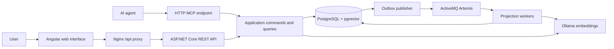

# Knowledge Base System

A self-hosted knowledge base for AI-assisted development. Store reusable skills, scoped policies, projects, feature plans, research records, and conversation memories in one place, then access them through a web interface, REST API, or Model Context Protocol (MCP) tools.

The application combines an Angular frontend, an ASP.NET Core API, an event-sourced backend, and local semantic search powered by Ollama and PostgreSQL with pgvector.

## Contents

- [Features](#features)
- [How it works](#how-it-works)
- [Requirements](#requirements)
- [Installation](#installation)
- [Service addresses](#service-addresses)
- [Configuration](#configuration)
- [MCP and agent integrations](#mcp-and-agent-integrations)
- [Local development](#local-development)
- [Tests](#tests)
- [Operations and troubleshooting](#operations-and-troubleshooting)
- [Repository structure](#repository-structure)
- [License](#license)

## Features

- **Skills:** reusable instructions, references, attachments, use scenarios, and project associations.
- **Policies:** rules scoped to general use, projects, topics, or agent families.
- **Projects:** repository mappings and links to relevant skills and policies.
- **Features:** feature information, plans, and linked records such as research and planning conversations.
- **Memory:** captured conversations, summaries, and attachments for later retrieval.
- **Search:** keyword and semantic retrieval across stored knowledge, plus focused search tools for individual content types.
- **Administration:** projection replay, outbox inspection, unique-constraint rebuilding, and code-review settings.
- **Agent integrations:** MCP tools and repository-provided hooks for Claude and Codex.

## How it works



Changes to event-sourced entities are stored as events. YAML state-machine definitions select event validators and projections. Events are authoritative; projections provide read models for lists, details, and search.

Outbox processing publishes messages to ActiveMQ Artemis, and projection workers update the read models. Because this happens asynchronously, a successful write can take a short time to appear in lists or search results.

Ollama runs `qwen3-embedding:0.6b` locally to generate 1,024-dimensional embeddings. Search uses PostgreSQL text search and vector similarity. The default setup does not require an external AI API key for embeddings.

## Requirements

### Running the Docker stack

| Requirement | Purpose |
| --- | --- |
| Git | Clone this repository and its event-sourcing submodule. |
| Docker with Docker Compose v2 | Build and run the application and infrastructure containers. |
| NVIDIA GPU with a working driver and Docker GPU support | Required by the supplied Ollama service. On Linux, configure NVIDIA Container Toolkit for Docker. |
| Internet access during initial setup | Download container images, build dependencies, the Git submodule, and the embedding model. |
| Available host ports | `4200`, `5231`, `5432`, `5673`, `8162`, `8081`, and `11435`. |
| Persistent storage | Store PostgreSQL data, broker data, container images, and the downloaded model. |

The default Compose configuration **requires CUDA and deliberately refuses CPU fallback**. Its Ollama entrypoint also stops the service if GPU access is lost or a model runs on the CPU. A CPU-only machine or a machine without NVIDIA GPU passthrough cannot run this configuration unchanged.

The commands below use Bash. On Windows, run them in a WSL environment with Docker integration and NVIDIA GPU access configured. Native macOS does not satisfy the supplied stack's NVIDIA requirement.

The examples use `docker compose`. If Compose v2 is installed as the standalone `docker-compose` executable, replace `docker compose` with `docker-compose` throughout the commands. The rebuild scripts support either form.

### Developing outside Docker

Install these only for the parts you intend to run locally:

| Tool | Repository target |
| --- | --- |
| .NET SDK | .NET 8 for the API and backend tests. |
| Node.js and npm | The frontend Dockerfile uses Node.js `24.15.0`; use the same version to match the build environment. |
| Angular CLI | Installed locally by `npm ci`; no global CLI installation is necessary. The frontend uses Angular 22.1. |
| Python 3 | Optional, for Knowledge Base publishing scripts and agent integration tooling. |
| Bash and curl | Required by the integration-test runner. |

## Installation

Run the following from the directory where you want the repository checkout. This creates or reuses the checkout and persistent volumes, initializes the required submodule over HTTPS, and starts the full stack.

```bash
set -euo pipefail

if [ ! -d Knowledge-base-system ]; then
    git clone https://github.com/PULK4N/MCP-Skill-System.git Knowledge-base-system
fi
cd Knowledge-base-system

# The committed submodule URL uses SSH. Use HTTPS for this checkout so
# initialization does not require an SSH key (repository access is still required).
git submodule init
git config submodule.API/EventSourcing.url https://github.com/PULK4N/EventSourcing.git
git submodule update --init --recursive

docker compose version

# These volumes are declared external and are not created by Compose.
# Creating an existing volume reuses it without clearing its contents.
docker volume create mcp-skill-system_skill-memory-postgres-data
docker volume create mcp-skill-system_skill-memory-ollama-data

docker compose up --detach --build
docker compose ps --all
```

The first startup downloads the embedding model. The API waits for PostgreSQL and Artemis health checks and for `ollama-model-init` to finish successfully. The API then applies its database migrations automatically. No separate migration command is needed for normal startup.

`docker compose up --detach` returning does not guarantee that the application is ready. Check the container status and logs if the UI is not yet available. The model-init container exiting with code `0` is expected.

Open **[http://localhost:4200](http://localhost:4200)** for the web interface and **[http://localhost:5231/swagger](http://localhost:5231/swagger)** for REST API documentation.

The supplied Compose file is a local development configuration: it uses default database and broker credentials, exposes infrastructure ports, and runs the API in Development mode. The API startup does not configure authentication. Add access control, TLS, appropriate network restrictions, and deployment-specific credentials before exposing it beyond a trusted environment.

## Service addresses

| Service | Host address | Notes |
| --- | --- | --- |
| Web interface | `http://localhost:4200` | Nginx serves Angular and proxies `/api/` to the API. |
| REST API / Swagger | `http://localhost:5231/swagger` | Swagger is enabled in Development mode. |
| MCP | `http://localhost:5231/mcp` | Streamable HTTP transport. |
| PostgreSQL | `localhost:5432` | Database, username, and password: `skill_memory`. |
| PostgreSQL browser | `http://localhost:8081` | Also proxied through `http://localhost:4200/pgweb/`. |
| Artemis AMQP | `localhost:5673` | Container port is `5672`; username/password: `artemis`. |
| Artemis console | `http://localhost:8162/console/` | Also proxied through `http://localhost:4200/console/`. |
| Ollama | `http://localhost:11435` | Container port is `11434`. |

Inside the Docker network, services use Compose names such as `postgres`, `artemis`, and `ollama`, together with their container ports. Local processes use the host addresses above.

## Configuration

The main configuration files are:

- [`docker-compose.yml`](docker-compose.yml): services, ports, volumes, and container environment variables.
- [`API/API/appsettings.json`](API/API/appsettings.json): shared API settings.
- [`API/API/appsettings.Development.json`](API/API/appsettings.Development.json): local database and embedding settings.
- [`API/API/Properties/launchSettings.json`](API/API/Properties/launchSettings.json): local API launch profiles.
- [`StateMachines/`](StateMachines/): events, validators, and projection selections.
- [`SPA/nginx.conf`](SPA/nginx.conf): frontend serving and reverse proxies.

ASP.NET Core environment variables use double underscores for nested configuration keys:

| Key | Purpose |
| --- | --- |
| `ConnectionStrings__ApplicationDatabase` | PostgreSQL connection string. |
| `Embeddings__BaseUrl` | Ollama server URL. |
| `Embeddings__Model` | Embedding model; currently `qwen3-embedding:0.6b`. |
| `Embeddings__Dimensions` | Vector size; currently `1024`. |
| `Embeddings__NumGpu`, `Embeddings__MainGpu` | GPU allocation settings. |
| `Embeddings__NumCtx` | Embedding context size; currently `4096`. |
| `OutboxProcessing__BrokerUri` | Artemis AMQP connection URI. |
| `OutboxProcessing__UserName`, `OutboxProcessing__Password` | Broker credentials. |
| `ASPNETCORE_ENVIRONMENT` | Runtime environment, including whether Swagger is enabled. |

Keep embedding model dimensions consistent with the database vector schema. Changing the model also requires regenerating affected search embeddings; changing only the model name does not update existing vectors.

## MCP and agent integrations

Configure an MCP-compatible client to connect to `http://localhost:5231/mcp` using Streamable HTTP. Client configuration syntax varies; this is a server endpoint, not a browser page. A client running in another container or on another machine needs an address that reaches the API from that environment.

The MCP server exposes skills, policies, projects, features, memories, and knowledge-search tools. Focused tools such as `skill_search` and `feature_record_search` retrieve particular content types, while `knowledge_search` searches across sources.

Agent plugin sources live in:

- [`integrations/claude/plugins/mcp-knowledge-base/`](integrations/claude/plugins/mcp-knowledge-base/)
- [`integrations/codex/plugins/mcp-knowledge-base/`](integrations/codex/plugins/mcp-knowledge-base/)

Both include MCP configuration pointing to the local API. Hook integrations provide additional agent-specific behavior, including conversation capture. See the [Codex memory attachment notes](integrations/codex/plugins/mcp-knowledge-base/README.md) and [prompt usage tooling](scripts/PROMPT_USAGE.md) for the corresponding repository tools.

## Repository structure

```text
API/
  API/                    ASP.NET Core host and configuration
  ActionModule/           Shared command/query execution infrastructure
  DomainsModules/         Skills, policies, projects, features, memories, and more
  EventSourcing/           Event-sourcing framework (Git submodule)
  IntegrationModules/     PostgreSQL, embeddings, and outbox processing
  IntegrationTests/       HTTP MCP integration tests
SPA/                      Angular web application and Nginx configuration
StateMachines/            YAML event/validator/projection definitions
integrations/             Agent plugins and Artemis configuration
scripts/                  Rebuild, testing, publishing, and agent tooling
docker-compose.yml        Main development stack
docker-compose.integration-tests.yml
                          Disposable integration-test stack
```

Domain modules generally separate domain behavior, application commands and queries, persistence, and REST/MCP adapters. Their tests sit alongside the relevant layer.

## License

This repository is licensed under the [MIT License](LICENSE).
