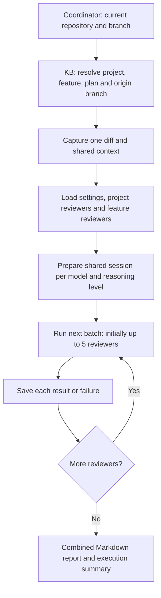
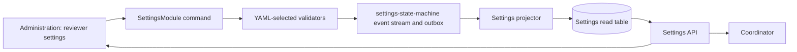
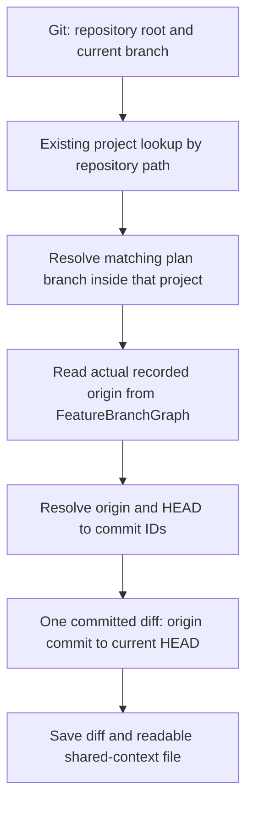
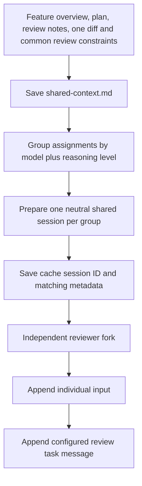
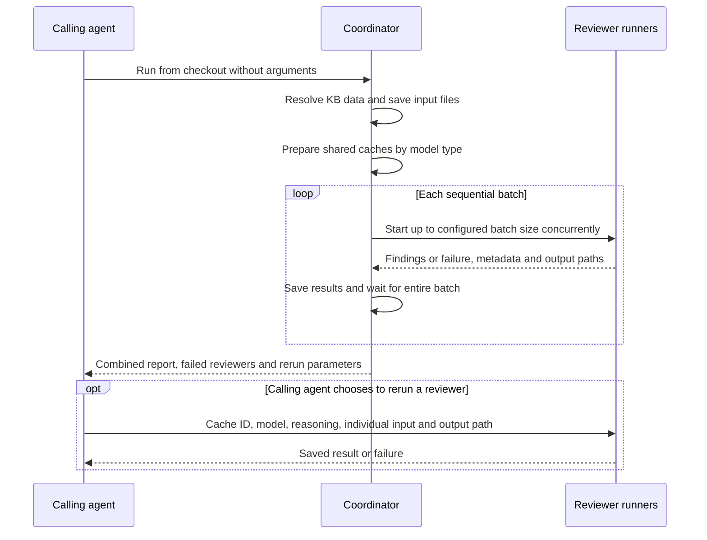
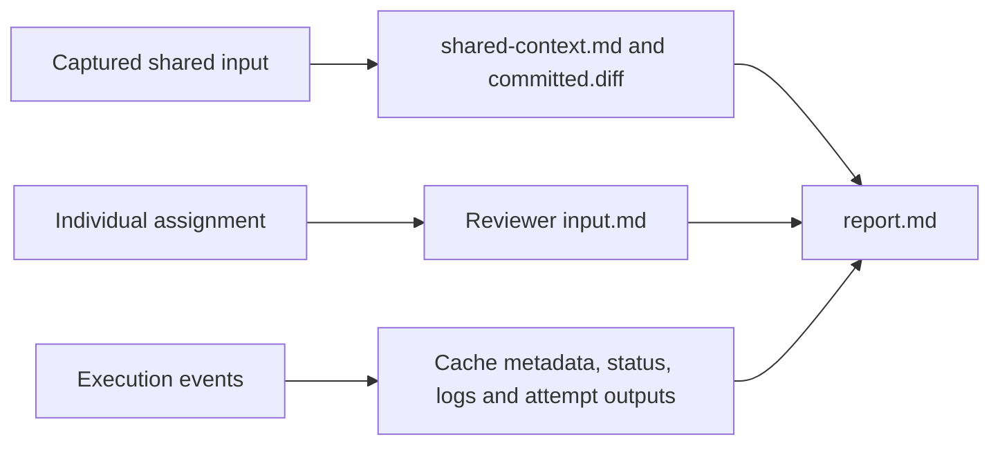
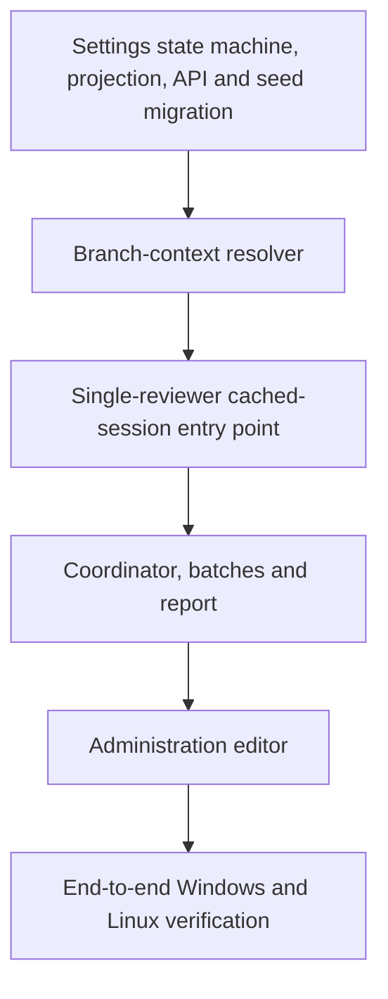

# Code reviewers — implementation plan

One argument-free coordinator discovers its review from the checkout and KB, runs configured reviewers in batches, and produces a readable report; the single-reviewer runner can also be called directly.

| KB branch association | Value |
| --- | --- |
| Feature branch | `feature/code-reviewers` |
| This plan's branch | `feature/code-reviewers-script` |
| This plan branch originated from | `feature/code-reviewers`, confirmed by the local checkout reflog |

## 1. Settings state machine and Administration

The settings event stream is authoritative; a simple settings table is its rebuildable read projection.

| Setting | Initial value | Validation |
| --- | --- | --- |
| Reviewer batch size | 5 | Positive integer |
| Shared review task message | Initial message below | Nonblank text |

| Component | Planned responsibility |
| --- | --- |
| `SettingsModule/Domain` | Singleton settings state; immutable initialization and review-settings update events; YAML-selected validators |
| `SettingsModule/Application` | Get settings query and update review settings command; typed DTOs |
| `SettingsModule/API` | Thin DI-backed settings endpoints |
| `SettingsModule/Persistence` | Settings projection, repository and shared context contract |
| `StateMachines/settings.yaml` | `settings-state-machine`, initialization/update events, validators and projector |
| `SharedModule.Constants.StateDataAggregateIds` | One unique settings aggregate ID |
| PostgreSQL provider module | Context mapping, scoped registrations and migrations |
| Administration | Reviewer settings tab with batch-size field, message editor, save state and errors |

- Keep the settings properties typed and flat; the initial slice contains reviewer configuration.
- Use the existing module/layer conventions and ActionController execution path; register actions in the API composition root.
- Add projection schema through a provider-owned migration. Seed the initial settings through paired event-store and outbox writes, guarded against duplicate initialization. Populate the settings table through projection delivery/replay.
- A separate settings module can coexist with the existing theme settings implementation; this feature does not require its migration.
- The Angular page is an observable-first UI controller with a typed HTTP service and observable loading, saving, success and error state.

### Initial shared review task message

This message is editable in Administration and appended after each reviewer's individual input.

> You are a code reviewer provided with feature details, a selected plan, review notes and code differences. For a project reviewer, use the supplied skill and optional reviewer note to find concrete code errors that indicate the skill was not followed properly. If the skill is not applicable, return "Nothing found (skill not applicable)". For a feature reviewer, use the supplied reviewer instructions to find concrete code errors; no skill is required. If no errors are found, return "Nothing found". For each actionable finding, include severity, file and line, the violated rule or instruction, concrete impact and the required change. Review the code without modifying it.

## 2. Resolve context from the current checkout

The coordinator discovers inputs locally; users do not supply feature IDs, plan IDs or branch arguments.

| API | Purpose |
| --- | --- |
| Existing `GET /api/policies/projects/by-repository?repositoryPath=...` | Resolve the project from the local repository path |
| Proposed `GET /api/features/review-context?projectId=...&branchName=...` | Resolve the unique feature/plan, actual origin branch, feature overview, plan content, review notes and feature reviewers |
| Existing `GET /api/projects/{projectId}/review` | Fetch enabled project review skills, notes, review levels and level-to-model mapping |
| Existing skill detail API | Fetch each selected skill and its references once |
| Proposed `GET /api/settings/code-review` | Fetch batch size and task message |
| Proposed `POST /api/settings/code-review` | Save settings through the settings state machine |

- The resolver is a scoped query in FeatureModule. Filter feature IDs by project, replay candidate feature streams in a batch, and match recorded plan branches exactly. Return a focused DTO rather than fetching every feature into the script.
- Use the domain `FeatureBranchGraph` and original plan branches, including completed plans. The presentation `FeatureBranchGraphBuilder` hides completed-plan branches and rewrites their visible origins; it is unsuitable for choosing the comparison baseline.
- A sub-branch originates from its recorded parent. A plan base branch uses its recorded source or the existing previous-plan/feature-branch default.
- Exactly one origin is needed for this feature's single comparison. Missing or ambiguous mappings/origins produce an actionable setup error; do not guess a branch or create additional comparisons.
- Compare the two captured branch-tip commits directly. The existing runner's merge-base comparison must not determine this coordinator's diff. Working-tree edits are outside this branch-to-branch diff.
- Validate mappings, reviewer settings, skill content and references before launching reviewers. Repository policies remain supplied in the shared context through the existing policy mechanism, rather than being added to feature retrieval.

## 3. Collect reviewers and prepare cached context

Shared context is independent of any individual reviewer and reusable only for its matching model type and content.

| Reviewer | Collected from | Individual input | Identity in reports |
| --- | --- | --- | --- |
| Project | Skills marked `UsedForReview` in project review configuration | Full skill and references, plus nonblank review note | Source `project` and skill ID |
| Feature | Reviewers stored on the feature | Saved title and reviewer instructions | Source `feature` and feature reviewer ID |

- Resolve Easy/Medium/Heavy through the project's existing level-to-model mapping for both reviewer types. Missing mappings fail validation.
- Keep reviewer source and source ID distinct. A skill ID alone is not a feature reviewer ID.
- Model type means **model + reasoning level**. Include the shared-content fingerprint and runtime identity in cache matching so stale or incompatible shared sessions are not reused.
- Cache preparation performs no review and includes no individual skill, note or feature-reviewer instruction. Each reviewer forks the neutral shared session independently.
- Preserve the existing read-only execution isolation and final-message extraction. Cached token counters are recorded when available; token savings and CLI compatibility require live verification.
- Only configured reviewers are collected; existing optional review modes do not create extra reviewers automatically.

## 4. Script responsibilities and batches

The coordinator has no required arguments; the reviewer runner has explicit parameters for direct invocation by the calling agent.

| Entry point or module | Responsibility |
| --- | --- |
| New coordinator script under `scripts/codex/` | Discover checkout/KB context; prepare caches; schedule batches; persist inputs/metadata; assemble report |
| Single-reviewer entry point | Accept cached session ID, model, reasoning level, reviewer input file, repository location and output location; execute one reviewer without requiring feature/plan IDs |
| Shared Python modules | KB access, context construction, cache handling, process ownership and result parsing |
| Existing `review_process.py` | Windows Job Object / Linux process-group ownership and cancellation, adapted only where orchestration requires it |
| Existing `run_codex_reviewers.py` | Reuse its execution and cache mechanisms; preserve its current entry point while adding the direct cached-session path |

- Batch size is a global maximum across all model types, initially 5. It is not multiplied by the number of model groups.
- Use deterministic reviewer order: project configuration order, followed by feature reviewer order. Wait until every reviewer in the batch has finished before starting the next batch.
- A failed reviewer does not prevent remaining reviewers or later batches from running. A shared-session preparation failure is reported for affected assignments; other model groups can still run.
- Save the settings snapshot used at startup; Administration changes affect subsequent coordinator runs.
- Cancellation stops scheduling, asks active runners to stop, and leaves useful partial outputs and cancelled statuses. Verify child-process cleanup on both operating systems.
- The calling agent can invoke the reviewer runner directly with the saved parameters. A dedicated retry script and a mandatory overall-run-file input are unnecessary.

## 5. Readable files, metadata and report

Persist the input text separately from cache IDs so the review remains inspectable.

| Saved artifact | Content |
| --- | --- |
| `shared-context.md` | Exact readable common prompt, including the selected feature context and diff |
| `committed.diff` | The single captured branch-to-branch patch |
| Settings snapshot | Batch size and task message used in this run |
| Per-model cache metadata | Model, reasoning, shared-content hash, session ID, runtime identity and available token counters |
| Per-reviewer `input.md` | Exact reviewer-specific input followed by the configured task message |
| Run/reviewer metadata | Reviewer source and source ID, model type, cache ID, status, timestamps, attempts, errors, output paths and direct-run parameters; feature/plan/commit IDs may be retained for traceability |
| Attempt files | Raw event output, stderr, final Markdown findings and status; reruns preserve earlier attempts |
| `report.md` | Results grouped by reviewer, with source, model, status and links to details |

- Store outputs in a run-specific subdirectory of the existing platform-appropriate review-cache location, and print its path. Use filesystem-safe directory names on Windows and Linux.
- The runner needs the cached session and individual assignment; it does not need feature/plan IDs to refetch already cached context.
- Keep findings, nothing found, skill not applicable, failed, and cancelled outcomes visible. Never turn an unavailable review into a clean result.
- Preserve reviewer attribution and findings in the combined report; retain individual artifacts for inspection and direct reruns.
- If a saved session is unavailable, report that prerequisite failure explicitly. Do not silently refetch current KB data under an old review's identity.
- Supporting source reads use the existing checkout. Save the reviewed HEAD and check it before starting a direct rerun; report a changed checkout instead of combining an old cached diff with another commit. Keep the checkout stable while reviewers run.

## 6. Implementation slices and verification

Finish and verify each slice before proceeding to the next.

| Slice | Verification |
| --- | --- |
| Settings | Event replay and YAML validation; reject zero/negative batch size and blank task; paired event/outbox seed; projection rebuild; settings read/update |
| Resolver | Repository scoping; exact plan match; sub-branch parent; default origin; completed origin retained; missing/ambiguous mapping; direct branch-tip diff with source-only commits |
| Single reviewer | Native CLI flags/session fork supported; correct prompt order; successful/non-applicable/failed results; missing cache; token metrics; cancellation and no orphan children |
| Coordinator | Mixed project/feature reviewers; same-model cache reused; reasoning/model differences isolated; batch limit 5 globally; no next batch before completion; failures do not halt later batches; exact input files and readable report |
| Direct rerun | Invoke the same runner from the printed saved parameters; recover the original shared session and reviewer input without requiring KB feature/plan IDs; retain prior attempt |
| Administration | Load/save/error behavior and validation in a browser; settings persist and affect the next coordinator run |
| Platforms and delivery | Python runs unchanged on Windows and Linux; focused checks first; frontend rebuild via `scripts/rebuild-frontend.sh`; backend changes committed for the user to rebuild the API |

| Current evidence | Status |
| --- | --- |
| Existing scripts and current API/UI contracts | Inspected |
| Reviewer execution, cache savings, Windows/Linux behavior | Unverified; existing scripts were copied from another repository |
| Implementation, tests, builds, migrations | Not performed during planning |
