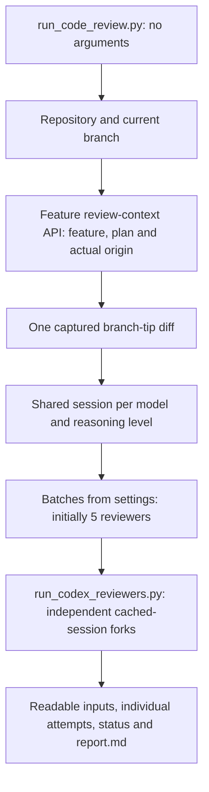
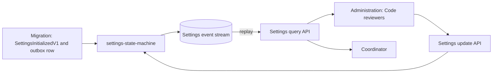
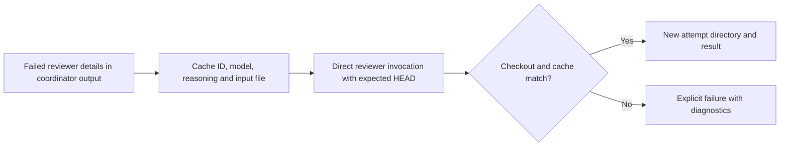
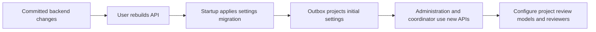

# Code reviewers — implementation and verification

## Implemented flow

The coordinator discovers all inputs from the checkout and KB; each reviewer can also be invoked directly with saved parameters.

## Settings

Settings are event-sourced without a projection: the settings query replays the singleton settings aggregate. The initial values are seeded as a paired event and outbox row; the outbox row is completed without publishing because the state machine declares no projections.

## Direct reruns

The calling agent uses the saved runner parameters; the runner does not fetch feature or plan data again.

## Verification

| Check | Result |
| --- | --- |
| Settings domain, event-replay query and real HTTP API | 8 tests passed |
| Feature application, including origin resolution | 68 tests passed |
| Feature API regression checks | 4 tests passed |
| Administration frontend | 32 tests passed |
| Python discovery, batches, failures, reruns and cancellation | 7 tests passed |
| Native coordinator with a fixture KB and temporary Git checkout | Project and feature reviewers completed using one shared session |
| Native cached-input usage on that fixture | Approximately 98% for both reviewers |
| Direct native rerun after fixture KB shutdown | Completed; previous attempt preserved |
| PostgreSQL migration in a scratch database | One initial event, one outbox row, batch size 5; no projection insert; seed guard did not duplicate rows |
| Playwright against rebuilt frontend | Load error, initial value, validation, save/reload, failed-save recovery and mobile layout passed using an isolated HTTP fixture |
| Frontend container | Rebuilt and running on port 4200 |

## Review and operational notes

| Item | Outcome |
| --- | --- |
| Request record validation | Corrected attribute placement; HTTP regression test passes |
| Controller discovery | Explicitly registered the settings controller assembly |
| Missing branch-origin references | Rejected instead of falling back to another branch |
| Python 3.8 text writes | Compatible file API used |
| Existing event-sourcing framework | No source changes |
| Windows runtime | Not executed on this Linux host; platform-specific process handling retained and portable script paths used |
| Existing frontend CSS budget warning | Feature details CSS warning remains unrelated to this change |

## Activate the backend

Backend rollout remains with the user; the running API container was not rebuilt or restarted.

See [the script usage guide](../../scripts/codex/README.md) for prerequisites, environment variables, artifacts and direct invocation details.
