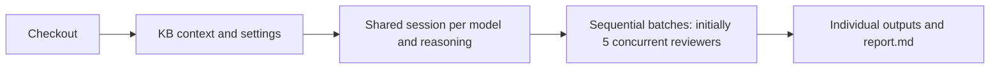

# KB-configured code reviews

Run from the Git checkout being reviewed, with Python 3.8 or newer, Git, and an authenticated native Codex CLI available. The KB API must include the settings and review-context endpoints, its initial settings event must be projected, and the current branch must belong to a KB plan with one recorded origin. Configure project review models and reviewers in the KB first.

```sh
python scripts/codex/run_code_review.py
```

The coordinator takes no arguments. It reads the current repository and branch, resolves the project and plan through the KB, captures the committed diff against the origin branch's current tip, and snapshots the review inputs. Working-tree edits are not added to the diff. Keep the checkout stable during the review.



| Environment variable | Purpose |
| --- | --- |
| `API_URL` | KB API address; defaults to `http://localhost:5231` |
| `KB_API_TOKEN` | Optional KB bearer token |
| `CODEX_REVIEW_EXECUTABLE` | Native Codex executable if it is not on PATH; use `codex.exe`, rather than a shell shim, on Windows |
| `CODEX_REVIEW_OUTPUT_ROOT` | Optional output location; otherwise runs live under the platform's KnowledgeBase review-cache directory |
| `CODEX_REVIEW_CACHE_ROOT` | Optional shared-session cache location; useful for isolated integration runs |
| `CODEX_HOME` | Existing Codex authentication/session location |

Administration → Code reviewers controls batch size and the shared task message. The coordinator reads these once per run. Project review levels select the model and reasoning for both project and feature reviewers. Individual skills, notes and feature instructions follow the shared cached context.

## Results and direct reruns

The final stdout line is JSON containing the report path, run status, reviewer identities, cache IDs, output paths and each reviewer's complete `runnerParameters` argument list. Full status is also stored in `status.json`. Exit codes are 0 for a completed run, 1 for setup errors or incomplete reviews, and 130 for cancellation.

| File | Content |
| --- | --- |
| `shared-context.md`, `committed.diff` | Readable cached input and captured patch |
| `settings.json` | Settings used for this run |
| `caches/*/cache.json` | Model-specific shared session and usage baseline |
| `reviewers/*/input.md` | Individual assignment and task message |
| `reviewers/*/attempt-*/` | Independent attempt status, raw logs and final findings |
| `report.md` | Findings and failures grouped by reviewer, with direct runner arguments |

For a manual rerun, invoke `run_codex_reviewers.py` with that reviewer's saved `runnerParameters` list. Its `--cache-id` mode requires the model, reasoning, individual input file, expected checkout commit and output directory. The optional cache metadata file validates the saved runtime identity and supplies the usage baseline. Feature and plan IDs are unnecessary, and this mode makes no KB requests. A new attempt directory preserves prior results.

The original `run_codex_reviewers.py --feature-id ... --plan-id ...` entry point remains available for compatibility with the earlier single-reviewer workflow.

## Verification

Run the deterministic checks from the repository root:

```sh
python -m unittest discover -s scripts/tests -p test_code_review.py -v
```

For the native integration check, keep the Codex login available and run from the repository root. It creates a temporary Git checkout and fixture KB, launches a project reviewer and a feature reviewer through the real coordinator, and prints the retained artifact location. It uses `gpt-6-luna` with `xhigh` reasoning by default; `CODEX_REVIEW_TEST_MODEL` and `CODEX_REVIEW_TEST_REASONING` can select another available fixture model type.

```sh
python scripts/tests/integration_code_review.py
```
